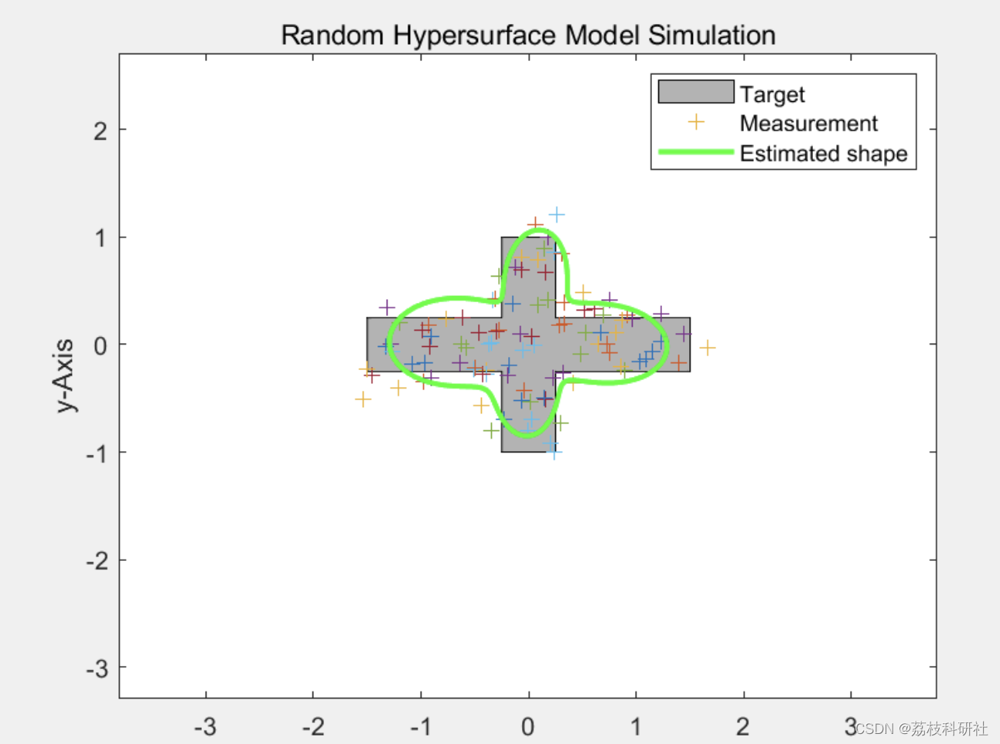

# Shape Tracking of Expansion Objects and Group Targets Using Star Convex Random Supersurface Model (Matlab Code)

In recent years, the problem of target tracking has received widespread attention. Estimating the shape of extended targets is a key research area for scholars, leading to the emergence of many methods for modeling the shape of extended targets. For example, Baum et al. modeled extended targets as random hypersurface models (RHM), which assume that the measurement sources of the target are distributed on a reduced version of the target boundary and that the measurements consist of measurement sources at the reduced boundary and sensor noise. The spherical RHM mainly describes the target contour using Fourier series expansion of radial functions, with the expansion coefficients used to model the shape of the extended target and scale factors to model the surface measurement sources. The RHM assumption that each measurement generated by the target is produced by its corresponding measurement source leads to a modeling method that can cause strong nonlinearity in the measurement equation.
📚2 Run results​ editing  
Part of the code:  
function randomHypersurfaceModel_2011(numberOfMeasurement)  
if nargin ==0  
numberOfMeasurement= 100;  
end  
% Number of Fourier coefficients  
nr_Fourier_coeff = 11;  
% State description prior [b0--bn, x, y]  
x = zeros(nr_Fourier_coeff + 2, 1);  
x(1) = 1.5;  
% State covariance prior  
C_x = diag([ones(1, nr_Fourier_coeff).*0.02, 0.3, 0.3]);
% Measurement noise  
measurementNoise = diag([0.2, 0.2].^2);  
% Scale properties  
scale.mean = 0.7;  
scale.variance = 0.08;  
% Angular resolution for plotting  
phi_vec = [0:0.01:2*pi];  
% Object size  
a = 3;   % -- width of the horizontal rectangle  
b = 0.5;  % | height of the horizontal rectangle  
c = 2;   % | height of the vertical rectangle  
d = 0.5;  % -- width of the vertical rectangle  
sizeObject = [a b c d];  
% Object shape bounds  
objectBounds = [[-d, -c];[d, -c];[d, -b];[a, -b];[a, b];[d, b];[d, c];  
[-d, c];[-d, b];[-a, b];[-a, -b];[-d, -b]]' ./ 2;  
% Main  
% Plot  
h_object = fill(objectBounds(1, :), objectBounds(2, :), [.7 .7 .7]);  
hold on  
xlim([-3 3]);  
ylim([-3 3]);  
axis equal  
xlabel('x-Axis')  
ylabel('y-Axis')  
title('Random Hypersurface Model Simulation')  
for j = 1 : numberOfMeasurement  
% Get new measurement  
newMeasurement = getNewMeasurement(sizeObject, measurementNoise);  
% Filter step  
[x, C_x] = UKF_FilterStep(x, C_x, newMeasurement, [scale.mean; [0 0]'], ...  
blkdiag(scale.variance, measurementNoise), @f_meas_pseudo_squared, nr_Fourier_coeff);  
% Plot  
shape = calcShape(phi_vec, x, nr_Fourier_coeff);  
h_measure = plot(newMeasurement(1), newMeasurement(2), '+');  
h_shape = plot(shape(1, :), shape(2, :), 'g-', 'linewidth', 2);  
legend([h_object, h_measure, h_shape],'Target', 'Measurement', 'Estimated shape')  
DrawNow;  
if j ~= numberOfMeasurement  
    delete(h_shape)  
end  
🎉3 References  
🌈4 Matlab Code Implementation

## Images

<!-- PAYMENT_BLOCK -->

## Get this dataset

- Payment link (Stripe): [Buy now](https://buy.stripe.com/3cs8yP7sY87d0vu9AB)
- Payment QR code: 

<!-- /PAYMENT_BLOCK -->
